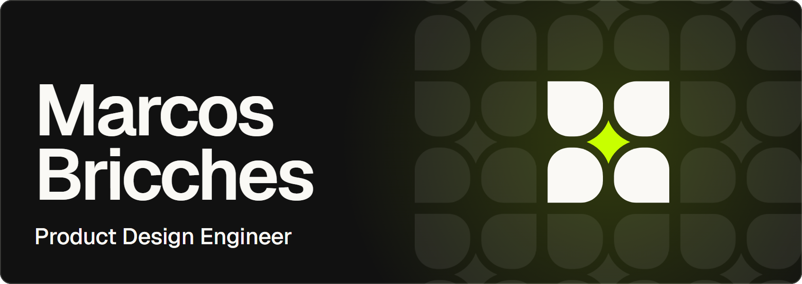
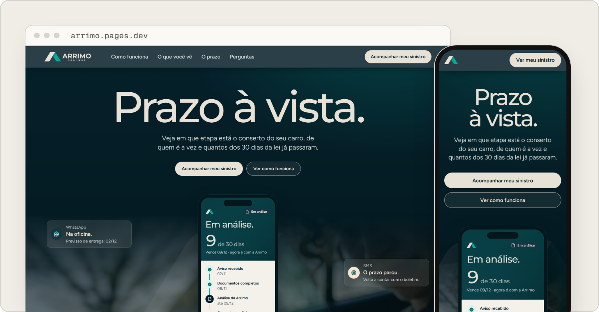
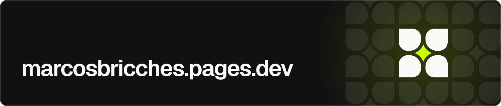

<a href="https://marcosbricches.pages.dev"><picture><source media="(max-width: 767px)" srcset="assets/header-phone.ef5e70e.png"></picture></a>

I take products end to end, from research and strategy to brand, a live product and its evaluation, with AI agents speeding up every stage and building what I specify.

### Arrimo

<a href="https://marcosbricches.pages.dev/work/arrimo/"><picture><source media="(prefers-color-scheme: dark)" srcset="assets/arrimo-dark.b04cca6.png"></picture></a>

My end-to-end case study for a fictional large insurer: a claim follow-up on the 30-day clock of Brazil's insurance contract law. I carried it from research on public complaints through strategy, brand, product, launch and evaluation, with AI agents I set up speeding up every stage. Only the company is fictional; the rules, figures and complaints are real and cited.

[Case study](https://marcosbricches.pages.dev/work/arrimo/) · [Live demo](https://arrimo.pages.dev) · [Brandbook (PDF)](https://marcosbricches.pages.dev/work/arrimo/arrimo-livro-da-marca.pdf)

 

[marcosbricches.pages.dev](https://marcosbricches.pages.dev) · [LinkedIn](https://www.linkedin.com/in/marcosbricches) · [Behance](https://www.behance.net/marcosbricches) · [marcos.bricches@gmail.com](mailto:marcos.bricches@gmail.com)
