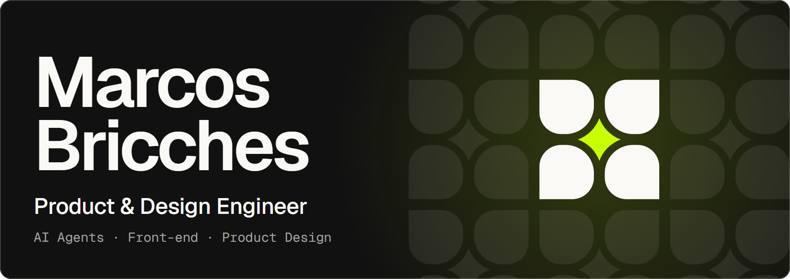
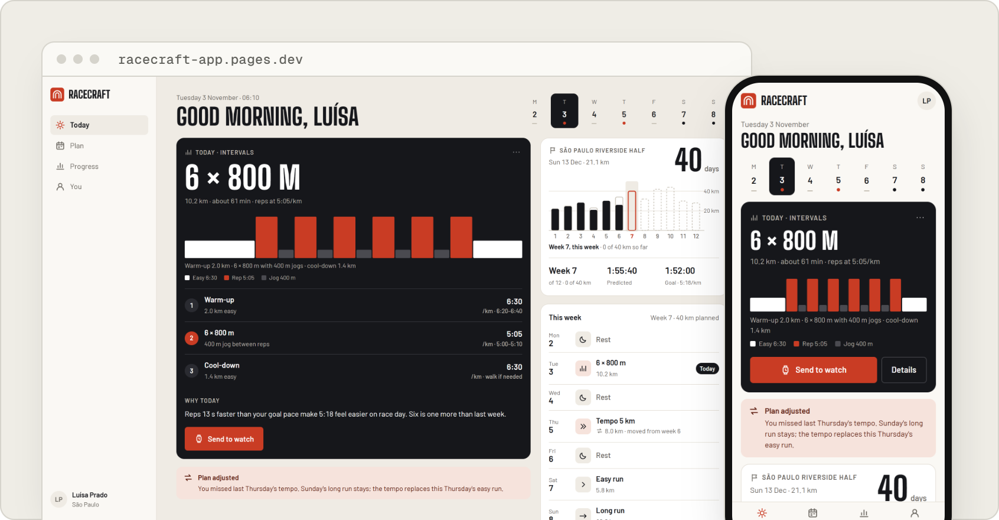
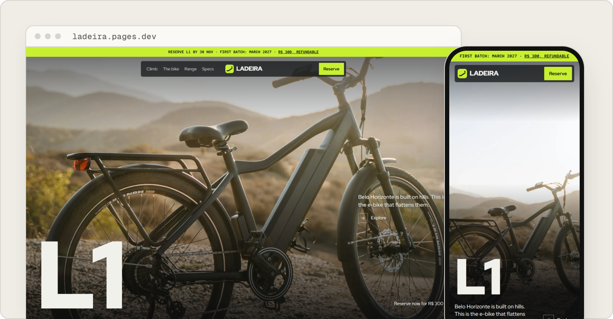
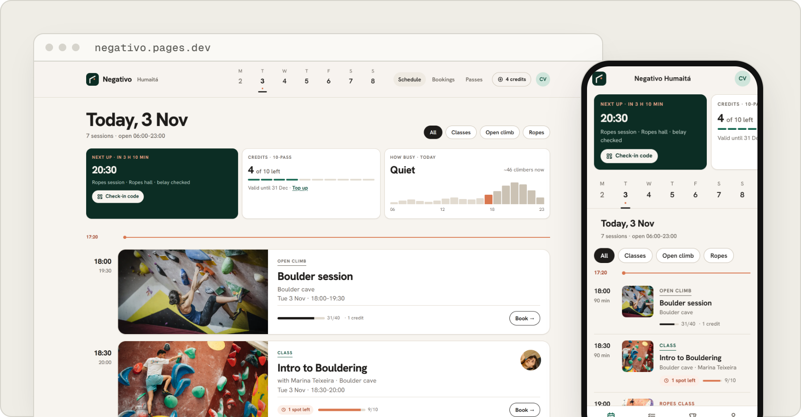
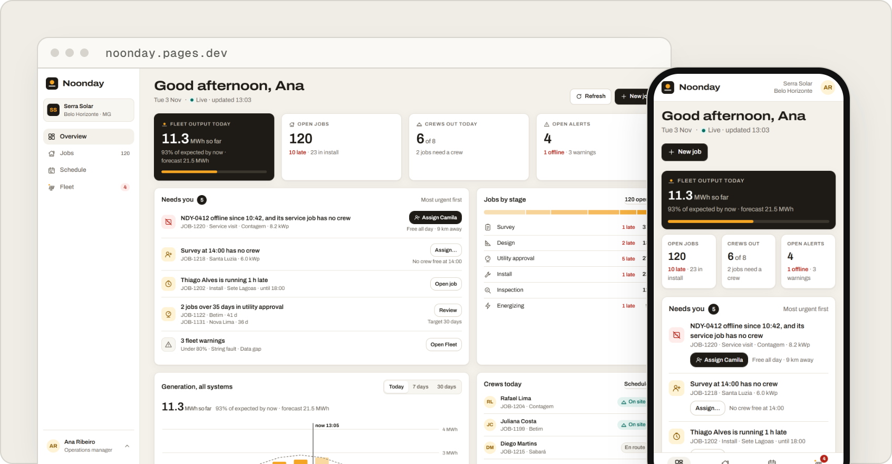
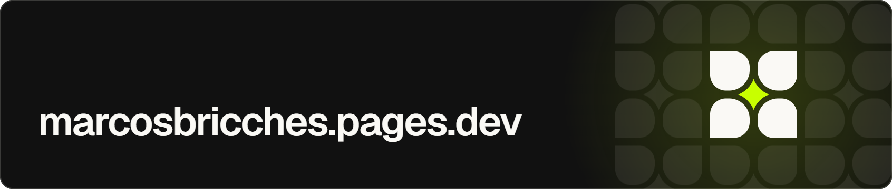

<a href="https://marcosbricches.pages.dev"><picture><source media="(max-width: 767px)" srcset="assets/header-phone.5bdfa97.png"></picture></a>

I design products and direct AI agents to build them, taking a client's problem to working software in the production stack, and I measure what the agents deliver.

Each of the four sample products below has its own brand and runs live on mocked data.

### Racecraft

<a href="https://racecraft-app.pages.dev"><picture><source media="(prefers-color-scheme: dark)" srcset="assets/racecraft-dark.409adde.png"></picture></a>

A training plan app for amateur runners. It builds a plan toward one race, reads each run back from the watch and moves the weeks around when a session is missed.

[Live demo](https://racecraft-app.pages.dev) · [Case study](https://marcosbricches.pages.dev/work/racecraft/) · [Code](https://github.com/marcchws/racecraft)

### Ladeira

<a href="https://ladeira.pages.dev"><picture><source media="(prefers-color-scheme: dark)" srcset="assets/ladeira-dark.4f5f9c3.png"></picture></a>

The launch site of a city e-bike made for the hills of Belo Horizonte, with a configurator that takes a refundable R$ 300 reservation.

[Live demo](https://ladeira.pages.dev) · [Case study](https://marcosbricches.pages.dev/work/ladeira/) · [Code](https://github.com/marcchws/ladeira)

### Negativo

<a href="https://negativo.pages.dev"><picture><source media="(prefers-color-scheme: dark)" srcset="assets/negativo-dark.dbb09f3.png"></picture></a>

The booking app of a climbing gym in Rio. Classes with waitlists, open-climb slots, passes, a waiver on the first visit and checkout by credits, Pix or card.

[Live demo](https://negativo.pages.dev) · [Case study](https://marcosbricches.pages.dev/work/negativo/) · [Code](https://github.com/marcchws/negativo)

### Noonday

<a href="https://noonday.pages.dev"><picture><source media="(prefers-color-scheme: dark)" srcset="assets/noonday-dark.849e1ab.png"></picture></a>

An operations dashboard for solar installers. Jobs, crews and the output of every installed system feed one queue of what needs the manager today.

[Live demo](https://noonday.pages.dev) · [Case study](https://marcosbricches.pages.dev/work/noonday/) · [Code](https://github.com/marcchws/noonday)

 

[marcosbricches.pages.dev](https://marcosbricches.pages.dev) · [LinkedIn](https://www.linkedin.com/in/marcosbricches) · [Behance](https://www.behance.net/marcosbricches) · [marcos.bricches@gmail.com](mailto:marcos.bricches@gmail.com)
